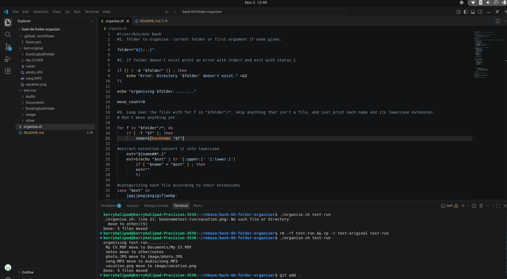

# 🏷 Project Name

The program helps to sort your folders in seconds, placing according to the order pictures, documents, others and tells the number of files sorted

---

## 📌 Problem Statement

Describe the real-world problem this project solves.

Example:
Imagine your Downloads folder, Photos, PDFs, installers, ZIP files, CVs, all mixed together.
Organise.sh mission is to tidie up any folder in seconds by sorting files into sub-folders by type.

---

## 🎯 Project Goals

- Tidies up your folders into sub-folders by type, without overwriting content.

---

## 🛠 Tech Stack

**VS Code**  
Bash script

**Other Tools:**  
Git & GitHub  

---

## 🖥 Features

- Automatic Categorization
- Safe collision handling
- Lazy folder creation
- Detailed execution feedback

---

## 📷 Screenshots



---

## ⚙ Installation & Setup

```bash
git clone [https://github.com/kerry-halipad/bash-06-folder-organiser.git](https://github.com/kerry-halipad/bash-06-folder-organiser.git)
cd bash-06-folder-organiser.git

🧠 Challenges Faced
Handing the collisions was a hurdle; organising it and the if condition before the while loop.

📚 What I Learned
How write a full bash program
Managing file names and extensions
Writing errors from my own scipt
Debugging linter errors


 Future Improvements
- **Dry-run mode:** Add a preview option to see what the script will do before it actually moves any files.
- **Custom categories:** Allow users to set up their own folder names and file extensions using a simple configuration file.
- **Undo feature:** Add a way to reverse the organization process if files were moved by mistake.
- **Sub-folder sorting:** Expand the script to organize files inside nested sub-folders instead of just the main folder.

👨🏽‍💻 Author
Your Moma Fongho Halipad-kerry Ambo
Junior Developer
📩 Email: kerryhalipad@gmail.com
🌍 Based in Cameroon | Open to remote opportunities


